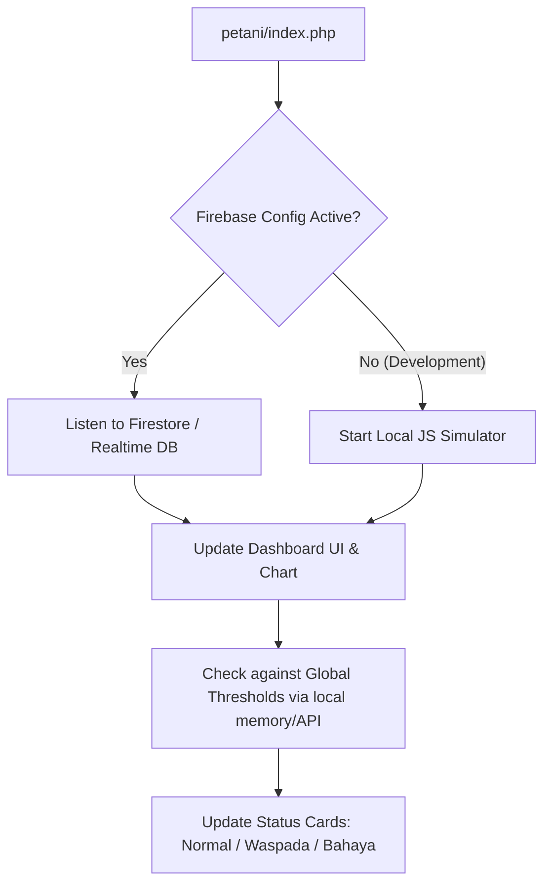

# Implementasi Website Fullstack Pemasaran dan Dashboard Monitoring MicroClimeet (Updated)

Rencana ini disesuaikan berdasarkan pilihan desain Anda:
1. **Firebase JS SDK Integration**: Dashboard petani terhubung langsung ke Firebase di sisi klien untuk update real-time data sensor secara instan. Landing page, autentikasi, log aktivitas, dan data administratif dikelola oleh PHP Native + MySQL.
2. **Light Mode Glassmorphism**: Estetika modern bernuansa segar, putih susu semi-transparan dengan efek blur halus, teks kontras tinggi, dan bayangan lembut.
3. **Fitur Admin Terfokus**: Persetujuan pendaftaran petani, log aktivitas pengguna, dan konfigurasi ambang batas (*threshold*) sensor global.
4. **Landing Page CTA**: Pendaftaran akun demo dengan simulator data dan tombol kontak cepat WhatsApp.

---

## Yang Perlu Dipersiapkan

1. **Lingkungan Server Lokal**:
   - Laragon/XAMPP (PHP 8.x + MySQL).
2. **Aset Visual & Font**:
   - Logo MicroClimeet.
   - Google Fonts **Outfit** & **Inter**.
   - Pustaka SVG Icon (Lucide Icons) secara CDN.
3. **Client-Side Libraries**:
   - Firebase JS SDK (CDN) untuk mendengarkan perubahan data Firestore / Realtime Database.
   - ApexCharts.js (CDN) untuk grafik tren interaktif.
   - **Simulator Data Lokal (Sementara)**: Script JavaScript di sisi dashboard untuk menghasilkan data simulasi real-time sebelum Firebase dikonfigurasi sepenuhnya.

---

## Desain Database (Skema MySQL)

Database lokal digunakan untuk manajemen pengguna, hak akses, log aktivitas, dan konfigurasi threshold global.

```sql
CREATE DATABASE IF NOT EXISTS microclimeet;
USE microclimeet;

-- 1. Tabel Users (Admin dan Petani)
CREATE TABLE users (
    id INT AUTO_INCREMENT PRIMARY KEY,
    name VARCHAR(100) NOT NULL,
    email VARCHAR(100) UNIQUE NOT NULL,
    password VARCHAR(255) NOT NULL,
    phone VARCHAR(20) NULL,
    role ENUM('admin', 'petani') DEFAULT 'petani',
    status ENUM('active', 'inactive') DEFAULT 'inactive', -- Approval Admin
    created_at TIMESTAMP DEFAULT CURRENT_TIMESTAMP
);

-- 2. Tabel Log Aktivitas (Untuk pemantauan Admin)
CREATE TABLE activity_logs (
    id INT AUTO_INCREMENT PRIMARY KEY,
    user_id INT NOT NULL,
    activity VARCHAR(255) NOT NULL,
    accessed_at TIMESTAMP DEFAULT CURRENT_TIMESTAMP,
    FOREIGN KEY (user_id) REFERENCES users(id) ON DELETE CASCADE
);

-- 3. Tabel Threshold Global (Ambang batas kondisi tanaman)
CREATE TABLE global_thresholds (
    id INT AUTO_INCREMENT PRIMARY KEY,
    sensor_type ENUM('temperature', 'humidity', 'air_quality', 'uv') UNIQUE NOT NULL,
    min_val DECIMAL(5,2) NOT NULL,
    max_val DECIMAL(5,2) NOT NULL,
    updated_at TIMESTAMP DEFAULT CURRENT_TIMESTAMP ON UPDATE CURRENT_TIMESTAMP
);

-- Seeding default thresholds
INSERT INTO global_thresholds (sensor_type, min_val, max_val) VALUES
('temperature', 20.00, 30.00),
('humidity', 60.00, 85.00),
('air_quality', 0.00, 50.00),
('uv', 0.00, 5.00)
ON DUPLICATE KEY UPDATE min_val=VALUES(min_val), max_val=VALUES(max_val);
```

---

## Konsep Gaya Visual & Spesifikasi Aset (Ref: Screenshot)

### 🎨 Sistem Warna (CSS Variables)
Sesuai dengan palet warna referensi yang Anda berikan, kita menggunakan CSS Variables berikut:

```css
:root {
  --bg-gradient: linear-gradient(135deg, #f3f9f5 0%, #e1eff6 50%, #c7e0ed 100%);
  --glass-bg: rgba(255, 255, 255, 0.5);
  --glass-border: rgba(255, 255, 255, 0.7);
  --glass-shadow: 0 8px 32px 0 rgba(114, 156, 81, 0.08);
  --text-primary: #0a0909;        /* Charcoal Black */
  --text-secondary: #4a554f;      /* Soft Muted Greenish-Grey */
  --accent-color: #729c51;        /* Fresh Green */
  --accent-orange: #eb5011;       /* Energetic Orange Accent */
  --warning-color: #eb5011;       /* Bold Alert */
  --danger-color: #ef4444;        /* Soft Crimson */
  --normal-color: #729c51;        /* Healthy Green */
}
```

### 🗂️ Struktur Halaman Landing Page (index.php)
Landing Page dirancang menggunakan layout sekuensial yang sangat informatif dan persuasif:
1. **Header (Navbar Navigation)**:
   - Sisi kiri: Logo MicroClimeet.
   - Tengah: Menu navigasi (Home, Fitur, Produk, Harga, FAQ).
   - Sisi kanan: Tombol login transparan dan tombol "Coba Demo" solid (aksen hijau).
2. **Hero Section (First Impression)**:
   - Sisi kiri: Tagline *"Pantau Greenhouse Anda Secara Real-Time"* dengan sub-headline persuasif dan tombol CTA ganda (Hubungi WA / Coba Demo).
   - Sisi kanan: Mockup/Visual produk [microclimeet.png](file:///c:/laragon/www/coba_microclimeet/microclimeet.png) yang melayang lembut dengan efek *soft-shadow*.
3. **Problem & Solution Section (Analisis Pasar)**:
   - Menjelaskan hambatan petani dalam pemantauan manual (suhu tidak stabil, risiko gagal panen premium).
   - Memperkenalkan MicroClimeet sebagai jawaban terintegrasi (Alat IoT + Monitor Jarak Jauh).
4. **Product Showcase Section (Spesifikasi IoT)**:
   - Grid interaktif yang mendetailkan 3 sensor utama: **BME680** (Suhu & Kelembapan), **PMS5003** (Kualitas Udara), dan **GUVA-S12SD** (Indeks UV).
   - Menjelaskan fitur fisik alat: Panel Surya mandiri, layar LCD lokal, dan casing 3D print kokoh.
5. **Pricing Section (Paket Penjualan)**:
   - 3 Kartu Harga Glassmorphic:
     * *Paket Alat Mandiri* (Rp 3.000.000)
     * *Paket Alat + Pemasangan* (Rp 3.200.000)
     * *Paket Lengkap + Website Monitoring* (Rp 3.350.000, langganan Rp 150.000/bln).
6. **Footer Section**:
   - Hak cipta, info tim pengembang (Program WIBAWA UNS 2026), dan ikon sosial media.

### 🧭 Mekanisme Sidebar Navigasi Dinamis (Sidebar Hover)
Untuk mengimplementasikan transisi logo yang Anda minta pada sidebar dashboard:
- **Kondisi Standar (Cursor di luar Sidebar)**:
  - Sidebar mengecil (*collapsed*, lebar ~80px).
  - Teks menu disembunyikan (`opacity: 0` & `visibility: hidden`).
  - Menampilkan [mini_logo.png](file:///c:/laragon/www/coba_microclimeet/mini_logo.png) di bagian atas.
- **Kondisi Hover (Cursor mengarah ke Sidebar)**:
  - Sidebar melebar (*expanded*, lebar ~260px) dengan transisi mulus (`transition: width 0.3s ease`).
  - Teks menu muncul perlahan (`transition: opacity 0.3s ease`).
  - Mengganti logo menjadi [logo.png](file:///c:/laragon/www/coba_microclimeet/logo.png).

---

## Struktur Folder Frontend & Backend

```text
coba_microclimeet/
├── assets/
│   ├── css/
│   │   ├── style.css       # Core layout & Light Glassmorphism variables
│   │   ├── dashboard.css   # Side navbar, grid cards, widgets
│   │   └── landing.css     # Clean landing page & auth cards
│   ├── js/
│   │   ├── firebase-config.js  # Stub konfigurasi Firebase (siap diisi nanti)
│   │   ├── db-simulator.js     # Simulator real-time data sensor jika Firebase belum aktif
│   │   └── main.js             # Event listeners & manipulasi UI dashboard
│   └── images/
├── config/
│   └── database.php        # PDO database connection
├── includes/
│   ├── header.php          # SEO tags & Google Fonts CDN
│   ├── footer.php
│   ├── sidebar.php         # Side Navbar Glassmorphism
│   └── auth_check.php      # Session validator
├── admin/
│   ├── index.php           # Dashboard Admin (Overview & System Thresholds)
│   ├── users.php           # Approval Petani
│   └── logs.php            # Log Aktivitas Petani
├── petani/
│   ├── index.php           # Dashboard Petani (Real-time monitoring)
│   └── settings.php        # Kalibrasi Sensor Lokal (Offset & Profile)
├── login.php
├── signup.php
└── index.php               # Landing Page Pemasaran (WhatsApp CTA & Demo Register)
```

---

## Alur Data Real-Time di Frontend (Firebase & Simulator)



---

## Tahap Pelaksanaan Kode

1. **Tahap 1**: Inisialisasi struktur file, file database config, dan tabel MySQL.
2. **Tahap 2**: Pembuatan Landing Page pemasaran clean, responsif, dengan CTA WhatsApp dan tombol "Coba Akun Demo" yang mengarah ke `signup.php`.
3. **Tahap 3**: Pembuatan halaman `signup.php` (status awal `inactive`) dan `login.php` dengan gaya Glassmorphism Light Mode yang estetik.
4. **Tahap 4**: Pembuatan Dashboard Petani (`petani/index.php`) lengkap dengan Side Navbar, 4 panel sensor glassmorphism, dan integrasi grafik tren ApexCharts. Dashboard akan mendeteksi Firebase; jika belum terkonfigurasi, ia akan otomatis menjalankan JS Simulator agar visual dashboard langsung berjalan dinamis.
5. **Tahap 5**: Pembuatan Dashboard Admin (`admin/index.php`) yang memungkinkan admin menyetujui akun petani, memantau log aktivitas, dan memperbarui ambang batas sensor global.
6. **Tahap 6**: Finishing, optimasi transisi hover, efek blur kaca di berbagai resolusi layar, dan pengujian.
